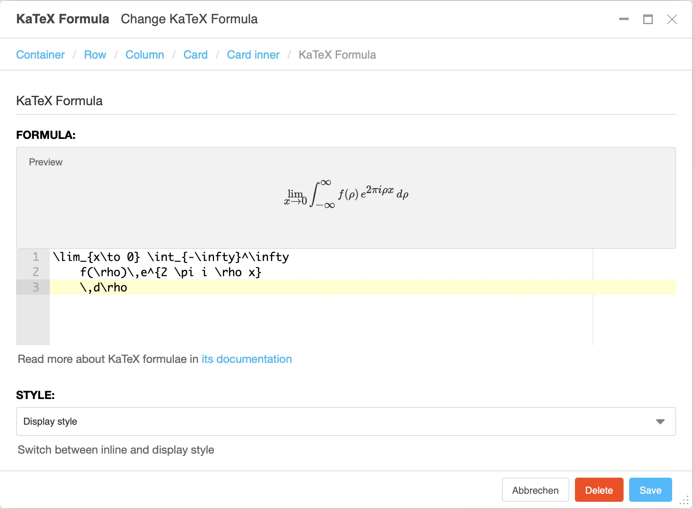

# djangocms-katex

[](https://badge.fury.io/py/djangocms-katex)
[](https://pypi.org/project/djangocms-katex/)
[](https://www.djangoproject.com/)
[](https://www.django-cms.org/)

Provides a django CMS plugin to render formulae using [KaTeX](https://katex.org)
and its mhchem extension for chemical equations.

The plugin can display formulae either inline or in display style.
It is text-enabled, and you can add formulae to the rich text fields
of [djangocms-text](https://github.com/django-cms/djangocms-text).

The plugin form has a live preview of the typed formula. Errors are shown in red.



## Installation

* Run `pip install djangocms-katex`
* Add the following entry to your `INSTALLED_APPS`:
  ```
  "djangocms_katex",
  ```
* Run `python manage.py migrate`

djangocms-katex adds its stylesheets and scripts to the page using
[django-sekizai](https://github.com/django-cms/django-sekizai). Ensure that your
base template renders the sekizai blocks `css` and `js`, as is standard for django CMS
projects:

```html

<html>
  <head>
    ...
    
  </head>
  <body>
    ...
    
  </body>
</html>
```

KaTeX, including its fonts, is bundled with djangocms-katex and served from your
project's static files. The page does not load anything from a third party.

### Ace code editor

The plugin form uses the ace code editor which is loaded from a CDN by default.
If you want the ace code editor to be served from your static files, install
`djangocms-katex[static-ace]` instead of `djangocms-katex` and add
`djangocms_static_ace` to your project's `INSTALLED_APPS`.

## Usage

Once installed, a new plugin ("KaTeX Formula") is available and can be added
to any placeholder or within a text plugin.

Formulae are written in LaTeX, see the list of
[functions supported by KaTeX](https://katex.org/docs/supported). The plugin offers
three styles:

* **Inline style**: The formula is part of the text flow
* **Display style**: The formula is centered on its own line
* **Display style flush left**: The formula is left-aligned on its own line

Chemical equations use mhchem's `\ce{}` and `\pu{}` commands, e.g.,
`\ce{2H2 + O2 -> 2H2O}`. The mhchem extension is only loaded on pages which need it.

Macros defined with `\gdef` in one formula are available in all following formulae
on the same page.

Formulae in display style which are wider than their container can be scrolled
horizontally, e.g., on small screens.

## Formulae in Markdown

If [djangocms-markdown](https://github.com/fsbraun/djangocms-markdown) (version 1.1 or
later) is installed, you can write formulae directly in Markdown content. No
configuration is needed with django CMS 4.1 or later.

```markdown
Let $a^2 + b^2 = c^2$ be the sides of a triangle, then

$$
\cos\gamma = \frac{a^2 + b^2 - c^2}{2ab}
$$
```

* **Inline formulae** are enclosed in single dollar signs: `$x^2$`. The opening `$`
  must not be followed by white space. The closing `$` must not be preceded by white
  space nor be followed by a digit. Hence, "from $5 to $10" is not a formula.
* **Display formulae** start with `$$` at the beginning of a line and end with `$$` at
  the end of a line. They can span several lines but cannot contain blank lines.
  Alternatively, use LaTeX's `\[` and `\]` in the same way. Elsewhere in a line, `\[`
  and `\]` remain Markdown's escaped brackets.
* Use `\$` for a dollar sign if a text is mistaken for a formula.
* Formulae in code spans and code blocks are left untouched.
* Chemical equations, site-wide options and macros work as in the KaTeX plugin.
* The preview of the Markdown editor renders the formulae.

Markdown plugins store their rendered content when they are saved. Formulae in existing
Markdown plugins hence only appear after the plugins have been saved again.

The Markdown plugin adds the required stylesheets and scripts to the page. If you render
a `MarkdownField` in your own templates, use djangocms-markdown's ``
template tag.

To switch the integration off, set `DJANGOCMS_KATEX_MARKDOWN = False`.

With django CMS 3.11, or with Python-Markdown outside of djangocms-markdown, add the
extension yourself, e.g., `DJANGOCMS_MARKDOWN_EXTENSIONS = [..., "djangocms_katex.markdown"]`,
and add the assets to your base template:

```html


```

`` adds the stylesheets and a small script to the sekizai blocks `css`
and `js`. KaTeX itself is only loaded on pages containing formulae. The editor preview
is not available in this case.

## Settings

All settings are optional.

```python
# KaTeX options applied to all formulae, see https://katex.org/docs/options
# Values need to be JSON-serializable.
DJANGOCMS_KATEX_OPTIONS = {
    "leqno": True,
    "minRuleThickness": 0.06,
}

# Macros available in all formulae
DJANGOCMS_KATEX_MACROS = {
    r"\RR": r"\mathbb{R}",
    r"\abs": r"\left|#1\right|",
}

# Formulae in djangocms-markdown content (default: True)
DJANGOCMS_KATEX_MARKDOWN = False
```

For the plugin, `displayMode` and `fleqn` are set by its style and cannot be overridden.
Display formulae in Markdown are centered unless `fleqn` is set in the options.
The previews in the plugin form and in the Markdown editor use the same options and macros.

## Notes

* Formulae are rendered in the browser. The LaTeX source is hidden until the formula is
  rendered. If JavaScript is not available, the source is shown instead.
* djangocms-katex does not use inline scripts and hence works with a strict content
  security policy.
* Inline editing of rich text might interfere with KaTeX's layout. If you add formulae
  to text plugins and encounter issues, consider deactivating inline editing
  (djangocms-text-ckeditor: remove `TEXT_INLINE_EDITING = True` from your settings).

## Development

Run the tests with

```
pip install -e ".[test]"
python -m pytest
```
